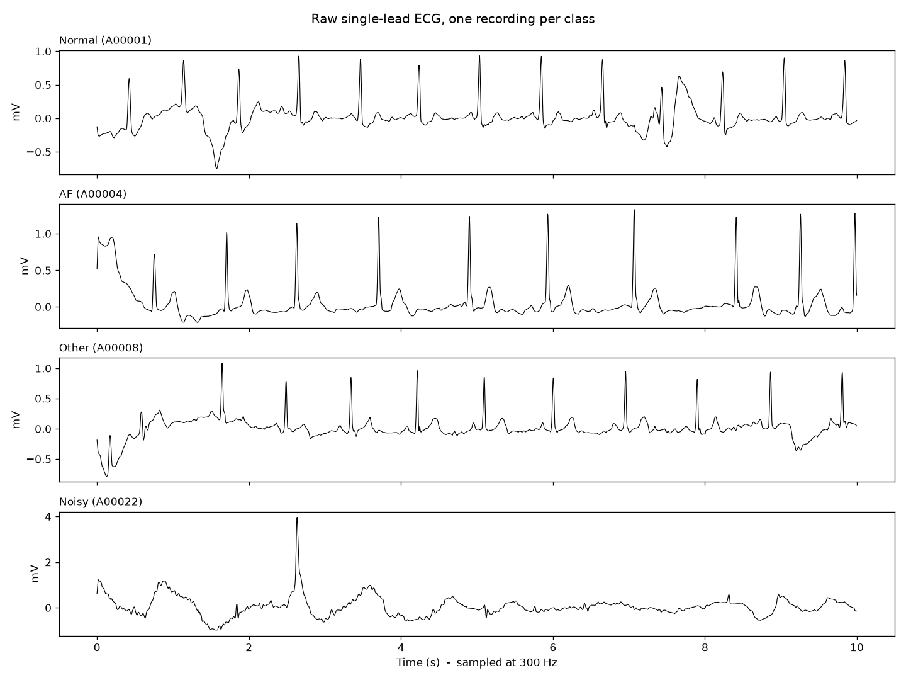
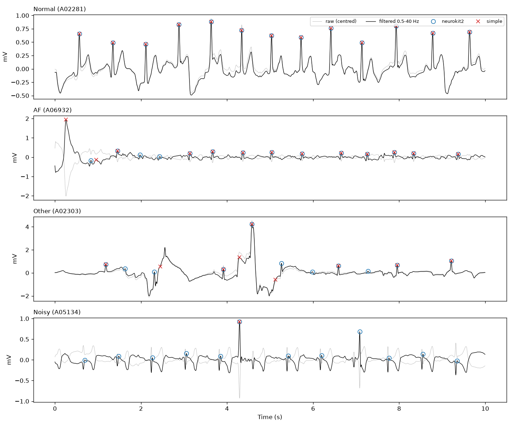
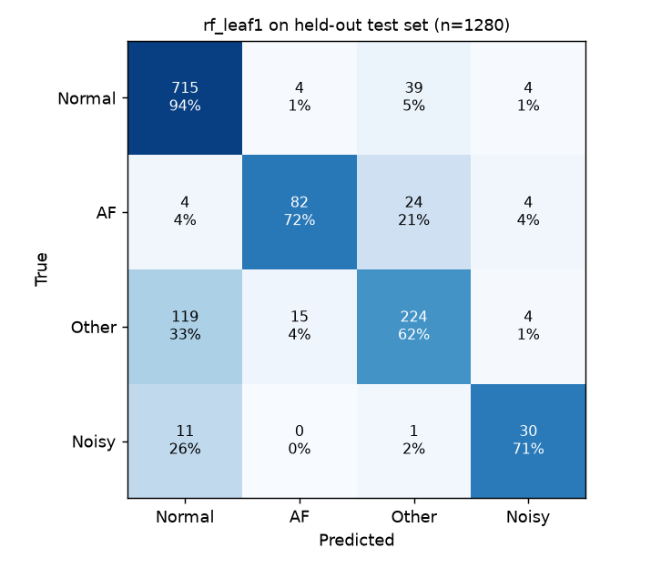
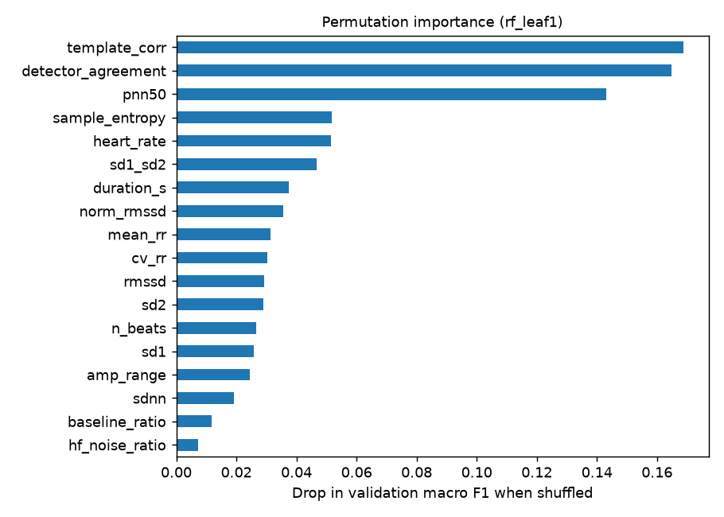

# Atrial fibrillation detection from single-lead ECG

Classifies 9-60 second single-lead ECG recordings as **Normal**, **AF**, **Other
rhythm** or **Noisy**. It uses a signal-processing pipeline (filtering, R-peak
detection, heart-rate-variability and signal-quality features) and a random
forest. Includes a Streamlit web demo.

> **Not a medical device.** Research and education project only.

## Problem

Atrial fibrillation is the most common sustained arrhythmia and a major cause
of stroke, but it is often intermittent and asymptomatic. Consumer devices
(e.g. AliveCor KardiaMobile) record short single-lead ECGs, which makes
automated screening attractive. It is also hard: one lead, short recordings,
lots of noise, and an "Other rhythm" class that includes many arrhythmias that
can look like AF.

## Dataset

[PhysioNet/Computing in Cardiology Challenge 2017](https://physionet.org/content/challenge-2017/1.0.0/):
8,528 AliveCor recordings, 300 Hz, in millivolts, labelled with the final
`REFERENCE-v3.csv` labels.

| Class  | Recordings | Share |
|--------|-----------:|------:|
| Normal | 5,076 | 59.5% |
| AF     |   758 |  8.9% |
| Other  | 2,415 | 28.3% |
| Noisy  |   279 |  3.3% |

The raw data is not in this repository. `scripts/download_data.py` fetches it.



## Approach

1. **Bandpass filter, 0.5-40 Hz** (4th-order Butterworth, zero-phase): removes
   baseline wander and muscle/mains noise without shifting R-peaks in time.
2. **Polarity correction**: many handheld recordings are inverted. Each
   recording is flipped if the median per-window minimum is larger in
   magnitude than the median per-window maximum.
3. **R-peak detection** with neurokit2, plus a simple Pan-Tompkins-style
   detector written from scratch. On 400 recordings the simple detector found
   97-100% of neurokit2's beats in the Normal, AF and Other classes but only
   ~61% in Noisy ones. That disagreement is used as a quality feature.
4. **18 features per recording**:
   - *RR irregularity*: RMSSD, RMSSD / mean RR, SDNN, coefficient of variation,
     pNN50, Poincare SD1, SD2 and SD1/SD2, sample entropy, heart rate.
   - *Signal quality*: beat-template correlation, detector agreement, amplitude
     range, power above 40 Hz and below 0.5 Hz, duration.
5. **Models**: logistic regression and random forest, both with class weighting
   for imbalance and a median imputer (with missing-value flags) inside the
   pipeline.
6. **Evaluation protocol**: stratified 70/15/15 train/validation/test split.
   Hyperparameters and model choice are made on validation only. The chosen
   model is refit on train+validation and scored **once** on the test set.



## Results (held-out test set, n = 1,280)

| Model | F1 Normal | F1 AF | F1 Other | F1 Noisy | Macro F1 | Challenge F1 (N/A/O) |
|---|---:|---:|---:|---:|---:|---:|
| Logistic regression (C=10) | 0.82 | 0.66 | 0.58 | 0.49 | 0.64 | 0.69 |
| **Random forest** | **0.89** | **0.76** | **0.69** | **0.71** | **0.76** | **0.78** |

For context, the top 2017 challenge entries scored about 0.83 on the official
hidden test set, which is a different test set, so the numbers are not directly
comparable.

For AF, the random forest catches 72% of AF recordings (82/114, the recall), and 81% of its
AF predictions are correct (precision).



### What the model gets wrong

- **Other predicted as Normal (119 of 362 Other recordings)** is the biggest error.
  "Other" includes many rhythms (ectopic beats, flutter, bundle branch block,
  tachycardia) whose RR intervals can be regular. Our features mostly describe
  RR irregularity and overall beat shape, so a regular rhythm with abnormal
  morphology looks Normal to the model.
- **AF predicted as Other (24 of 114)**. Some AF recordings are short or have a
  fast, only mildly irregular ventricular response. Frequent ectopic beats in
  the Other class are also irregular. Telling them apart needs P-wave or
  f-wave information, which this pipeline does not measure.
- **Noisy predicted as Normal (11 of 42)**. Some noisy recordings still contain
  enough clean beats for the features to look normal. Labels for Noisy are
  also the least consistent in the dataset.

The most important features (permutation importance on validation) are
beat-template correlation, detector agreement and pNN50. Signal quality matters
as much as rhythm irregularity.



## Web demo

`app/streamlit_app.py` lets you pick a sample recording (streamed from
PhysioNet, not stored here) or upload a WFDB `.hea` + `.mat` pair or a
one-column CSV in mV at 300 Hz. It shows:
- the filtered trace with R-peaks
- the predicted class and per-class scores
- the most important features compared with each class's typical value

<!-- TODO: add a screenshot or GIF of the deployed demo here: docs/demo.png -->

## How to run

```powershell
python -m venv .venv
.\.venv\Scripts\Activate.ps1
pip install -r requirements.txt
pip install -e .

python scripts/download_data.py     # ~100 MB, about a minute
python scripts/explore_data.py      # class balance + raw plots
python scripts/compare_peaks.py     # detector comparison + peak plots
python scripts/build_features.py    # features table, about 1-2 min
python scripts/train_baselines.py   # trains, evaluates, saves models/model.joblib
pytest                              # 26 tests on synthetic signals, no download needed

streamlit run app/streamlit_app.py
```

## Project structure

```
src/af/         config, data loading, filtering, R-peaks, features, models
scripts/        download, explore, compare peaks, build features, train
tests/          pytest tests for filtering, peaks, features, data loading
app/            Streamlit demo + list of sample record names
models/         trained model used by the demo
reports/        metrics (results.json, CSVs) and figures
LEARNING.md     concept notes
```

## Limitations

- **Possible patient overlap.** The dataset has no patient IDs, so recordings
  from the same person could appear in both train and test. That would
  inflate the scores.
- **Single dataset, single device.** The model has only seen AliveCor
  recordings at 300 Hz. Other devices, sampling rates or lead placements are
  untested.
- **No atrial-activity features.** P-wave absence and fibrillatory waves are
  key clinical AF criteria, but they aren't modelled here.
- **"Other" is very broad.** It is one label covering many different rhythms,
  which caps achievable performance.
- **Uncalibrated scores.** The demo's class probabilities are not calibrated
  clinical confidence.
- **Recording duration is a feature.** It helps slightly, likely because of
  how the dataset was collected, not because of physiology. A deployed system
  should not rely on it.

## Possible next steps

- A small 1D CNN on the filtered signal, compared on the same split.
- P-wave / f-wave features (e.g. atrial activity power in the TQ segment).
- Probability calibration and a threshold tuned for AF sensitivity.

## Citation

Clifford GD, Liu C, Moody B, Lehman L, Silva I, Li Q, Johnson AEW, Mark RG.
*AF Classification from a Short Single Lead ECG Recording: the
PhysioNet/Computing in Cardiology Challenge 2017.* Computing in Cardiology 2017;44.

Goldberger AL et al. *PhysioBank, PhysioToolkit, and PhysioNet.* Circulation
2000;101(23):e215-e220.
